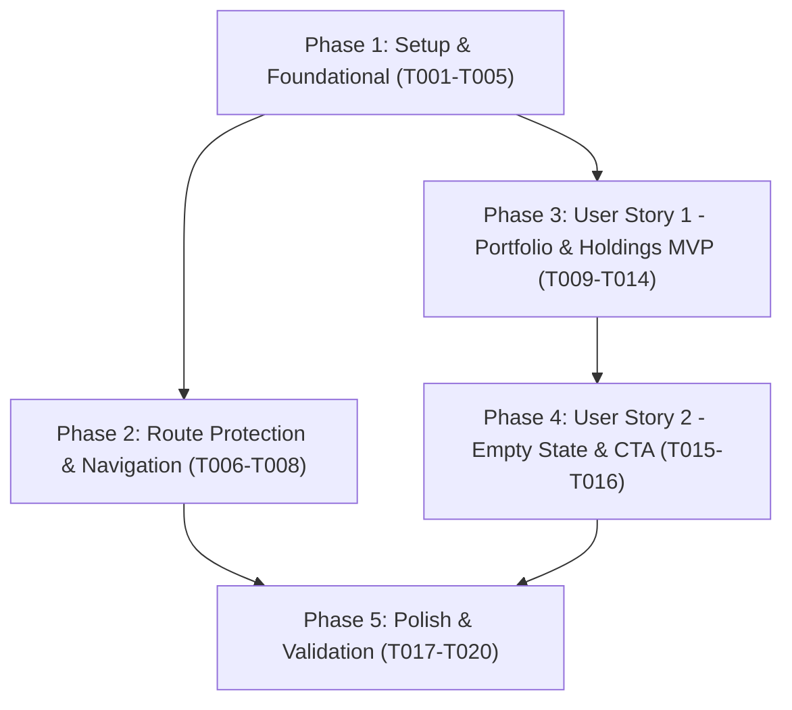

# Implementation Tasks: Frontend — Portfolio personal

**Feature Branch**: `018-frontend-portfolio`
**Specification**: [specs/018-frontend-portfolio/spec.md](file:///c:/Users/arodr/OneDrive/Desktop/Archivos/Universidad/Repos/desapp-gf/specs/018-frontend-portfolio/spec.md)
**Implementation Plan**: [specs/018-frontend-portfolio/plan.md](file:///c:/Users/arodr/OneDrive/Desktop/Archivos/Universidad/Repos/desapp-gf/specs/018-frontend-portfolio/plan.md)

---

## Phase 1: Setup & Foundational Infrastructure

**Purpose**: Core types, HTTP service, and data hook required by all user stories.

- [x] T001 Define portfolio interfaces (`Holding`, `PortfolioSummary`, `PortfolioResponse`) in `frontend/src/types/portfolio.ts`
- [x] T002 Implement `portfolioService.getPortfolio(userId: string)` using `httpClient.get` in `frontend/src/service/portfolioService.ts`
- [x] T003 [P] Direct unit tests for `portfolioService` mocking `fetch` in `frontend/src/service/portfolioService.spec.ts`
- [x] T004 Implement `usePortfolio` hook managing loading state, errors, portfolio snapshot, and retry in `frontend/src/hooks/usePortfolio.ts`
- [x] T005 [P] Direct unit tests for `usePortfolio` hook in `frontend/src/hooks/usePortfolio.spec.ts`

**Checkpoint**: Foundational layer complete. Types, service, and hook tested in isolation.

---

## Phase 2: User Story 3 - Restricción de acceso y navegación (Priority: P1)

**Goal**: Proteger la ruta `/portfolio` requiriendo sesión activa y añadir el enlace de navegación para usuarios autenticados.

**Independent Test**: Navegar a `/portfolio` sin estar autenticado redirige inmediatamente a `/login`. Al iniciar sesión, la ruta es accesible y visible en la barra de navegación.

- [x] T006 [US3] Register `/portfolio` route wrapped with `ProtectedRoute` and `AppLayout` in `frontend/src/routes/router.tsx`
- [x] T007 [P] [US3] Add "Portfolio" navigation link in desktop and mobile menus for authenticated users in `frontend/src/layout/AppLayout.tsx`
- [x] T008 [P] [US3] Write integration test in `frontend/test/portfolio.spec.ts` verifying unauthenticated access returns 401 or redirects to `/login`

**Checkpoint**: Acceso restringido y navegación listos para conectar la vista principal.

---

## Phase 3: User Story 1 - Consulta de estado y posiciones de inversión (Priority: P1) [MVP]

**Goal**: Visualizar el resumen global de inversiones (capital invertido, valor actual y ganancia/pérdida neta) y la lista de posiciones de tokens por jugador.

**Independent Test**: Iniciar sesión con un usuario que posee tokens de jugadores y verificar que la vista `/portfolio` muestra las tarjetas de resumen consolidadas y las filas/tarjetas de cada futbolista con sus valores y colores de rendimiento financiero.

- [x] T009 [P] [US1] Create `PortfolioSummary` component displaying Total Invertido, Valor Actual, and Ganancia/Pérdida neta with `#6ab547` (gain) and Tailwind red (loss) in `frontend/src/components/PortfolioSummary.tsx`
- [x] T010 [P] [US1] Isolated component tests for `PortfolioSummary` in `frontend/src/components/PortfolioSummary.spec.tsx`
- [x] T011 [P] [US1] Create `HoldingList` component rendering player holdings with name, quantity, buy price, current price, and position gain/loss in `frontend/src/components/HoldingList.tsx`
- [x] T012 [P] [US1] Isolated component tests for `HoldingList` in `frontend/src/components/HoldingList.spec.tsx`
- [x] T013 [US1] Implement `PortfolioPage` view orchestrating `PortfolioSummary`, `HoldingList`, loading indicator, and error banner with retry button in `frontend/src/pages/PortfolioPage.tsx`
- [x] T014 [US1] Write integration test in `frontend/test/portfolio.spec.ts` verifying portfolio data retrieval and rendering against real NestJS backend and Testcontainers PostgreSQL

**Checkpoint**: MVP completo. Los usuarios con inversiones activas pueden consultar su patrimonio y posiciones en snapshot sin polling.

---

## Phase 4: User Story 2 - Cartera vacía y exploración de jugadores (Priority: P1)

**Goal**: Presentar un estado vacío amigable ("Aún no tienes tokens en tu portfolio") con botón CTA al catálogo cuando el usuario no posee tenencias.

**Independent Test**: Iniciar sesión con un usuario nuevo sin tokens y comprobar que la vista muestra el mensaje amigable y que hacer clic en el botón CTA redirige a `/catalog`.

- [x] T015 [US2] Implement friendly empty state banner and CTA button redirecting to `/catalog` in `frontend/src/pages/PortfolioPage.tsx`
- [x] T016 [US2] Write integration test in `frontend/test/portfolio.spec.ts` asserting empty portfolio returns 200 with empty holdings array and displays the friendly empty state

**Checkpoint**: La experiencia para usuarios sin tenencias está completa y orientada a la acción.

---

## Phase 5: Polish & Cross-Cutting Concerns

**Purpose**: Verificación de compilación, ejecución integral de tests y validación final.

- [x] T017 [P] Verify clean build without TypeScript or lint errors via `pnpm --filter frontend build`
- [x] T018 Execute full unit and component test suites via `pnpm --filter frontend test:unit`
- [x] T019 Run full integration tests with Testcontainers via `pnpm --filter frontend test:integration`
- [x] T020 Run manual validation scenarios documented in `specs/018-frontend-portfolio/quickstart.md`

---

## Dependencies & Execution Order

### Phase Dependencies

- **Phase 1 (Foundational)**: Bloquea todas las historias de usuario.
- **Phase 2 (US3)**: Puede desarrollarse una vez finalizada la Fase 1.
- **Phase 3 (US1)**: Puede arrancar una vez finalizada la Fase 1. Representa el MVP funcional.
- **Phase 4 (US2)**: Extiende `PortfolioPage.tsx` para cubrir la condición de cartera vacía.
- **Phase 5 (Polish)**: Requiere todas las fases implementadas.

---

## Parallel Opportunities

- **Fase 1**: T003 (`portfolioService.spec.ts`) y T005 (`usePortfolio.spec.ts`) pueden desarrollarse en paralelo con sus implementaciones correspondientes.
- **Fase 2**: T007 (`AppLayout.tsx`) y T008 (`portfolio.spec.ts`) pueden implementarse en paralelo con T006 (`router.tsx`).
- **Fase 3**: T009/T010 (`PortfolioSummary.tsx` y su test) y T011/T012 (`HoldingList.tsx` y su test) pueden desarrollarse simultáneamente en paralelo al residir en componentes desacoplados.

---

## Implementation Strategy

### MVP First (User Story 1)

1. Completar Fase 1 (Tipos, Servicio, Hook y tests unitarios directos).
2. Completar Fase 2 (Ruta protegida `/portfolio` en `router.tsx` y link en `AppLayout.tsx`).
3. Completar Fase 3 (Componentes `PortfolioSummary`, `HoldingList`, vista `PortfolioPage` y test de integración con Testcontainers).
4. **Validar MVP**: El usuario autenticado con tokens ve su resumen y holdings.

### Incremental Delivery

1. Setup + Foundational (Fase 1) $\rightarrow$ Base testeada.
2. Route Protection (Fase 2) $\rightarrow$ Acceso seguro `/portfolio` verificado.
3. Portfolio & Holdings (Fase 3) $\rightarrow$ MVP funcional de inversión entregado.
4. Empty State & Catalog CTA (Fase 4) $\rightarrow$ Experiencia completa para usuarios sin tokens.
5. Polish & Verification (Fase 5) $\rightarrow$ CI en verde (`pnpm test:unit`, `pnpm test:integration`, `pnpm build`).

