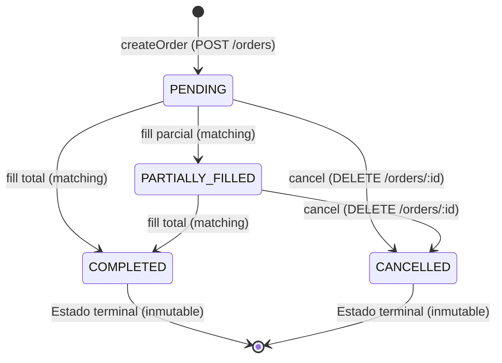

# Data Model: Cancelación de Órdenes

**Feature**: `023-cancel-order`  
**Date**: 2026-10-21  

---

## 1. Entidades de Dominio

### 1.1 `OrderStatus` (Extensión de Enum)

```typescript
export enum OrderStatus {
  PENDING = 'PENDING',
  PARTIALLY_FILLED = 'PARTIALLY_FILLED',
  COMPLETED = 'COMPLETED',
  CANCELLED = 'CANCELLED',
}
```

* **`PENDING`**: Orden recién creada sin ninguna ejecución (`remainingQuantity === quantity`). Estado cancelable.
* **`PARTIALLY_FILLED`**: Orden con ejecuciones parciales pero aún con remanente pendiente (`0 < remainingQuantity < quantity`). Estado cancelable.
* **`COMPLETED`**: Orden totalmente ejecutada (`remainingQuantity === 0`). Estado terminal; no cancelable.
* **`CANCELLED`**: Orden cancelada explícitamente por su propietario. Estado terminal; no cancelable.

---

### 1.2 `Order` (Entidad de Dominio)

Clase inmutable pura sin decoradores de persistencia (Principio I y II).

```typescript
export class Order {
  // Propiedades privadas
  private readonly _id: string;
  private readonly _userId: string;
  private readonly _playerId: string;
  private readonly _side: OrderSide;
  private readonly _quantity: number;
  private readonly _remainingQuantity: number;
  private readonly _price: number;
  private readonly _createdAt: Date;
  private readonly _status: OrderStatus;

  // Fábrica para nuevas órdenes
  static create(props: { ... }): Order;

  // Reconstrucción desde persistencia
  static restore(props: {
    id: string;
    userId: string;
    playerId: string;
    side: OrderSide;
    quantity: number;
    remainingQuantity: number;
    price: number;
    createdAt: Date;
    status?: OrderStatus;
  }): Order;

  // Operación de negocio: cancelación
  cancel(): Order;

  // Operación de negocio: ejecución de fill
  fill(quantity: number): Order;

  // Predicados de negocio
  get isCancellable(): boolean;
  isCompatibleWith(other: Order): boolean;

  // Getters
  get id(): string;
  get userId(): string;
  get playerId(): string;
  get side(): OrderSide;
  get quantity(): number;
  get remainingQuantity(): number;
  get price(): number;
  get createdAt(): Date;
  get status(): OrderStatus;
}
```

#### Invariantes y Reglas de Negocio de `Order`:
1. **Regla de Cancelabilidad (`isCancellable`)**:
   `isCancellable` es `true` únicamente si `status === OrderStatus.PENDING || status === OrderStatus.PARTIALLY_FILLED`.
2. **Invariante de `cancel()`**:
   Si `!this.isCancellable`, invocar `cancel()` lanza `OrderNotCancellableError`. Si es cancelable, retorna una nueva instancia con `_status = OrderStatus.CANCELLED`.
3. **Incompatibilidad de orden cancelada**:
   Si `status === OrderStatus.CANCELLED`, `isCompatibleWith(other)` devuelve siempre `false`, imposibilitando que participe en futuros cruces de mercado.
4. **Protección contra sobre-filleo**:
   Una orden con `status === OrderStatus.CANCELLED` no admite llamados a `fill(quantity)` (lanza `OrderNotCancellableError` o `OrderOverfillError`).

---

## 2. Máquina de Estados del Ciclo de Vida de una Orden



---

## 3. Errores de Dominio

| Error | Mensaje / Condición | Mapeo HTTP |
|---|---|---|
| `OrderNotFoundError` | "La orden solicitada no existe." | `404 Not Found` |
| `OrderForbiddenError` | "No tienes permisos para operar sobre esta orden." | `403 Forbidden` |
| `OrderNotCancellableError` | "La orden no se puede cancelar porque ya fue completada o cancelada previamente." | `409 Conflict` |

---

## 4. Persistencia (`OrderEntity`)

Tabla: `orders` (definida en `020-order-matching-engine`).

```typescript
@Entity('orders')
@Index('idx_orders_matching', ['playerId', 'side', 'price', 'status', 'createdAt'])
export class OrderEntity {
  @PrimaryColumn('uuid')
  id!: string;

  @Column({ name: 'user_id', type: 'uuid' })
  userId!: string;

  @Column({ name: 'player_id', type: 'uuid' })
  playerId!: string;

  @Column({ type: 'varchar', length: 4 })
  side!: string;

  @Column({ type: 'integer' })
  quantity!: number;

  @Column({ name: 'remaining_quantity', type: 'integer' })
  remainingQuantity!: number;

  @Column({ type: 'decimal', precision: 10, scale: 2 })
  price!: string;

  @Column({ type: 'varchar', length: 16 })
  status!: string; // Almacena 'CANCELLED' además de 'PENDING', 'PARTIALLY_FILLED', 'COMPLETED'

  @Column({ name: 'created_at', type: 'timestamptz' })
  createdAt!: Date;
}
```

* No se requieren migraciones DDL de base de datos adicionales, ya que el campo `status` es `varchar(16)`, el cual soporta perfectamente la cadena `'CANCELLED'`.
* El repositorio `TypeOrmOrderRepository` ya utiliza `OPEN_STATUSES = [OrderStatus.PENDING, OrderStatus.PARTIALLY_FILLED]`. Al persistirse `status = 'CANCELLED'`, la orden queda automáticamente fuera del alcance de `findCompatibleCandidates`, `lockCompatibleCandidates` y `sumPendingSellQuantity`.

