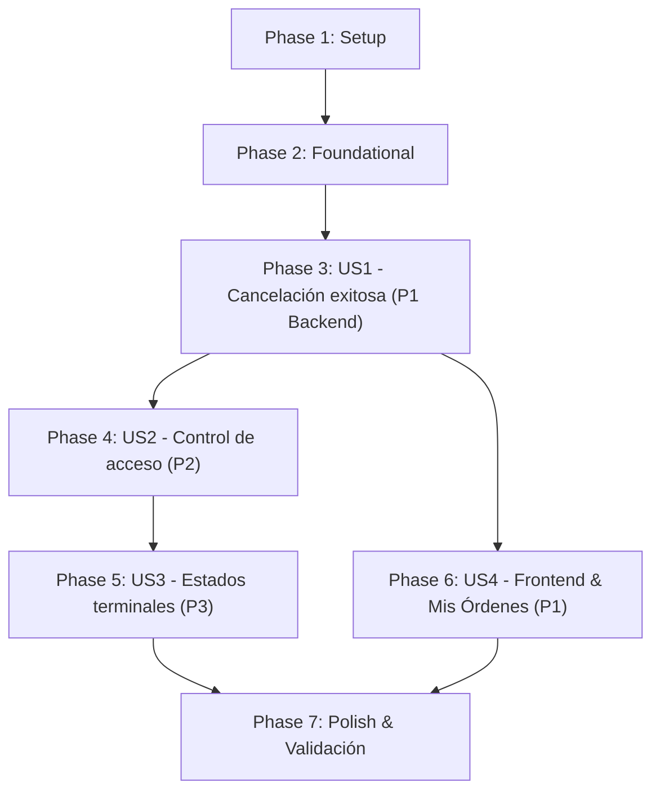

# Tasks: Cancelación de Órdenes (Order Cancellation)

**Input**: Design documents from `specs/023-cancel-order/` (`plan.md`, `spec.md`, `research.md`, `data-model.md`, `contracts/orders-api.md`, `quickstart.md`).  
**Prerequisites**: `plan.md` (required), `spec.md` (required), `research.md`, `data-model.md`, `contracts/orders-api.md`.  
**Tests**: Se incluyen tareas de pruebas unitarias en cumplimiento estricto del Principio IX de la Constitución.  
**Organization**: Tareas agrupadas por fases y por historias de usuario para posibilitar entregas incrementales y verificables de forma independiente.

---

## Phase 1: Setup (Shared Infrastructure)

**Purpose**: Definir constantes, enumeraciones y tipos compartidos para soportar el estado cancelado en backend y frontend.

- [X] T001 Extender `OrderStatus` con el valor `CANCELLED = 'CANCELLED'` en `backend/src/domain/orders/order-status.ts`
- [X] T002 [P] Extender `OrderStatus` con `'CANCELLED'` en `frontend/src/types/orders.types.ts`
- [X] T003 [P] Crear las clases de error de dominio `OrderNotFoundError`, `OrderForbiddenError` y `OrderNotCancellableError` en `backend/src/domain/orders/errors/`

---

## Phase 2: Foundational (Blocking Prerequisites)

**Purpose**: Habilitar el ciclo de vida de cancelación en la entidad de dominio `Order`, su persistencia y el manejo de errores global.

- [X] T004 Implementar el método `cancel()` y el getter `isCancellable` en la entidad de dominio `Order` en `backend/src/domain/orders/order.ts`
- [X] T005 [P] Escribir tests unitarios en `backend/src/domain/orders/order.spec.ts` para verificar la transición a `CANCELLED`, la exclusión en `isCompatibleWith` y el bloqueo de llamadas a `fill()`
- [X] T006 Actualizar el mapeador `OrderMapper` para convertir hacia y desde la entidad con el estado `CANCELLED` en `backend/src/repositories/orders/mappers/order.mapper.ts`
- [X] T007 [P] Declarar `findByIdWithLock(tx, id)` y `findByUserId(userId)` en `backend/src/repositories/orders/order.repository.ts` e implementarlos con `pessimistic_write` en `backend/src/repositories/orders/typeorm-order.repository.ts`
- [X] T008 [P] Configurar el mapeo de excepciones en `backend/src/shared/filters/all-exceptions.filter.ts` para transformar `OrderForbiddenError` en 403, `OrderNotFoundError` en 404 y `OrderNotCancellableError` en 409

**Checkpoint**: Base de dominio, repositorios y filtros lista. El desarrollo de las historias de usuario puede comenzar.

---

## Phase 3: User Story 1 - Cancelación exitosa de orden activa (Priority: P1) 🎯 MVP

**Goal**: Permitir que un usuario cancele una orden propia en estado `PENDING` o `PARTIALLY_FILLED`, retirándola del libro de órdenes y liberando los tokens retenidos si era una venta (`SELL`).

**Independent Test**: Invocar `DELETE /orders/:id` para una orden propia abierta y comprobar que responde 200 OK con estado `CANCELLED`, que su remanente no participa en matching y que los tokens de venta se liberan.

### Tests for User Story 1
- [X] T009 [P] [US1] Escribir tests unitarios en `backend/src/services/orders/orders.service.spec.ts` para validar la cancelación de órdenes PENDING y PARTIALLY_FILLED y la liberación del saldo retenido para órdenes SELL
- [X] T010 [P] [US1] Escribir tests unitarios en `backend/src/controllers/orders/orders.controller.spec.ts` para el endpoint `DELETE /orders/:id` verificando respuesta 200 OK y llamada a `OrdersService.cancelOrder`

### Implementation for User Story 1
- [X] T011 [US1] Implementar `cancelOrder(orderId, requesterId)` en `backend/src/services/orders/orders.service.ts` ejecutando la cancelación dentro de una transacción con lock pesimista
- [X] T012 [US1] Implementar el método `@Delete(':id') cancel` en `backend/src/controllers/orders/orders.controller.ts` delegando en `OrdersService.cancelOrder` y devolviendo `OrderResponseDto`

**Checkpoint**: User Story 1 (MVP Backend) funcional y testeada unitariamente.

---

## Phase 4: User Story 2 - Control de acceso y pertenencia (Priority: P2)

**Goal**: Garantizar que solo el usuario creador de la orden pueda cancelarla, rechazando intentos de usuarios ajenos con 403 Forbidden y solicitudes sin autenticación con 401 Unauthorized.

**Independent Test**: Intentar cancelar la orden de otro usuario y verificar respuesta 403 Forbidden; verificar que sin token responde 401 Unauthorized.

### Tests for User Story 2
- [X] T013 [P] [US2] Escribir tests unitarios en `backend/src/services/orders/orders.service.spec.ts` comprobando que si `order.userId !== requesterId` se arroja `OrderForbiddenError`
- [X] T014 [P] [US2] Escribir tests unitarios en `backend/src/controllers/orders/orders.controller.spec.ts` verificando que `OrderForbiddenError` produce una respuesta HTTP 403 Forbidden

### Implementation for User Story 2
- [X] T015 [US2] Agregar la verificación de propiedad del recurso en `cancelOrder` de `backend/src/services/orders/orders.service.ts` lanzando `OrderForbiddenError` cuando el solicitante no es el dueño
- [X] T016 [US2] Asegurar que `@UseGuards(JwtAuthGuard)` y `@CurrentUser()` protegen `DELETE /orders/:id` en `backend/src/controllers/orders/orders.controller.ts`

**Checkpoint**: Control de acceso completado y verificado.

---

## Phase 5: User Story 3 - Manejo de estados terminales y órdenes inexistentes (Priority: P3)

**Goal**: Informar adecuadamente mediante errores 404 Not Found cuando la orden no existe y 409 Conflict cuando ya se encuentra en un estado terminal (`COMPLETED` o previamente `CANCELLED`).

**Independent Test**: Enviar `DELETE /orders/:id` con un ID inexistente (404), con una orden COMPLETED (409) y con una orden ya CANCELLED (409).

### Tests for User Story 3
- [X] T017 [P] [US3] Escribir tests unitarios en `backend/src/services/orders/orders.service.spec.ts` verificando lanzamiento de `OrderNotFoundError` ante ID inexistente y `OrderNotCancellableError` ante órdenes COMPLETED o CANCELLED
- [X] T018 [P] [US3] Escribir tests unitarios en `backend/src/controllers/orders/orders.controller.spec.ts` verificando el mapeo a códigos HTTP 404 y 409

### Implementation for User Story 3
- [X] T019 [US3] Agregar las validaciones de existencia y de estado cancelable en `cancelOrder` de `backend/src/services/orders/orders.service.ts`
- [X] T020 [US3] Añadir decoradores `@ApiResponse` de Swagger en `backend/src/controllers/orders/orders.controller.ts` documentando los códigos 403, 404 y 409 para `DELETE /orders/:id`

**Checkpoint**: Robustez y manejo de errores de backend finalizado.

---

## Phase 6: User Story 4 - Consulta de órdenes y botón "Cancelar" en Frontend (Priority: P1)

**Goal**: Proveer la interfaz de usuario en el frontend para consultar las órdenes propias ("Mis órdenes") dentro del portfolio y permitir cancelar las órdenes abiertas mediante un botón "Cancelar".

**Independent Test**: Iniciar sesión en el frontend, navegar a Portfolio, visualizar la lista de órdenes propias y cancelar una orden PENDING/PARTIALLY_FILLED, verificando su transición visual a CANCELLED y la actualización del portfolio.

### Backend Support for Frontend
- [X] T021 [US4] Implementar `getUserOrders(userId)` en `backend/src/services/orders/orders.service.ts` y el endpoint `@Get() getOrders` en `backend/src/controllers/orders/orders.controller.ts`
- [X] T022 [P] [US4] Escribir tests unitarios en `backend/src/controllers/orders/orders.controller.spec.ts` para el endpoint `GET /orders`

### Frontend Service & Hook
- [X] T023 [P] [US4] Implementar `getUserOrders()` y `cancelOrder(orderId)` en `frontend/src/service/ordersService.ts` y escribir sus tests unitarios en `frontend/src/service/ordersService.spec.ts`
- [X] T024 [US4] Implementar el custom hook `useUserOrders` en `frontend/src/hooks/useUserOrders.ts` manejando estado de carga, lista de órdenes y mutación de cancelación, con sus tests en `frontend/src/hooks/useUserOrders.spec.ts`

### Frontend UI Components
- [X] T025 [US4] Crear el componente de presentación `MyOrders` en `frontend/src/components/MyOrders.tsx` renderizando la lista de órdenes, badges de estado y el botón "Cancelar" para órdenes activas, con sus tests en `frontend/src/components/MyOrders.spec.tsx`
- [X] T026 [US4] Integrar el componente `MyOrders` en `frontend/src/pages/PortfolioPage.tsx` y actualizar los tests de integración de la página en `frontend/src/pages/PortfolioPage.spec.tsx`

**Checkpoint**: Funcionalidad de frontend completa y enlazada con backend.

---

## Phase 7: Polish & Cross-Cutting Concerns

**Purpose**: Verificación integral de calidad, cobertura, linters y cumplimiento de arquitectura.

- [X] T027 [P] Ejecutar y verificar tests de arquitectura tsarch en `backend/test/architecture.spec.ts`
- [X] T028 [P] Ejecutar la suite completa de tests unitarios del backend con `pnpm test:unit`
- [X] T029 [P] Ejecutar la suite completa de tests unitarios del frontend con `npm run test:unit`
- [X] T030 Ejecutar la guía de validación end-to-end de `specs/023-cancel-order/quickstart.md` comprobando la experiencia de usuario

---

## Dependencies & Execution Order

### Phase Dependencies

* **Setup (Phase 1)**: Sin dependencias, inicia de inmediato.
* **Foundational (Phase 2)**: Depende de Phase 1. Bloquea todas las historias de usuario.
* **User Story 1 (Phase 3)**: MVP de backend. Depende de Phase 2.
* **User Story 2 (Phase 4)**: Depende de Phase 3 (añade control de acceso a la cancelación).
* **User Story 3 (Phase 5)**: Depende de Phase 4 (añade validación de estados y 404/409).
* **User Story 4 (Phase 6)**: Frontend & listado. Depende de Phase 3 (requiere `DELETE /orders/:id`).
* **Polish (Phase 7)**: Depende de la finalización de todas las historias de usuario.

---

## Parallel Opportunities

- **Phase 1**: T002 (frontend types) y T003 (backend errors) pueden ejecutarse en paralelo con T001.
- **Phase 2**: T005 (tests dominio), T007 (repositorio) y T008 (filtro HTTP) pueden correr en paralelo tras T004.
- **Phase 3**: T009 (tests servicio) y T010 (tests controlador) pueden prepararse en paralelo.
- **Phase 6**: T022 (backend GET test) y T023 (frontend service) pueden ejecutarse en paralelo.
- **Phase 7**: T027, T028 y T029 pueden correr en paralelo en distintas terminales.

---

## Implementation Strategy

### MVP First (User Story 1 - Backend)
1. Completar Setup (T001-T003) y Foundational (T004-T008).
2. Completar US1 Backend (T009-T012): `DELETE /orders/:id` operativo para órdenes PENDING/PARTIALLY_FILLED.
3. Validar con tests unitarios antes de avanzar.

### Incrementos Sucesivos
1. Incorporar US2 (T013-T016): Seguridad y propiedad (403 Forbidden).
2. Incorporar US3 (T017-T020): Estados terminales e inexistentes (404/409).
3. Incorporar US4 (T021-T026): Experiencia de usuario en Frontend (listado y botón Cancelar).
4. Verificación integral y cierre de calidad (T027-T030).

