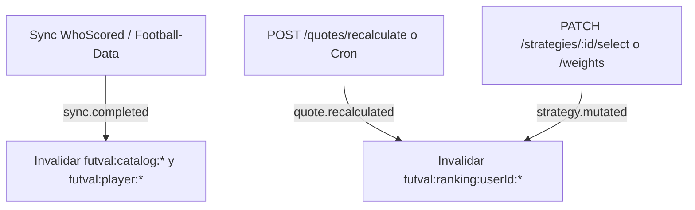

# Contrato de Claves de Caché, TTL e Invalidación

**Feature**: `031-redis-cache-fallback` | **Date**: 2026-11-17

Este documento define el contrato formal de generación de claves en Redis, sus TTLs, condiciones de invalidación y garantías de consistencia.

---

## 1. Claves y Políticas de Expiración

| Recurso / Endpoint | Formato de Clave | TTL | Estrategia de Invalidación |
|-------------------|------------------|-----|----------------------------|
| **Catálogo** (`GET /players`) | `futval:catalog:<hash>` | 3600 s (1 h) | Proactiva vía `delByPrefix('futval:catalog:')` tras `POST /sync/*` exitoso. |
| **Detalle de Jugador** (`GET /players/:id`) | `futval:player:<playerId>` | 3600 s (1 h) | Proactiva vía `delByPrefix('futval:player:')` tras `POST /sync/*` exitoso. |
| **Ranking Personal** (`GET /players/ranking`) | `futval:ranking:<userId>:<hash>` | 86400 s (24 h) | Proactiva vía `delByPrefix('futval:ranking:<userId>:')` tras recálculo o cambio de estrategia. |
| **Escudo de Club** | `futval:external:team-crest:<whoScoredName>` | 604800 s (7 d) | Expiración natural por TTL o actualización por `sync-crosswalk`. |
| **Clasificación Competición** | `futval:external:standings:<leagueCode>` | 604800 s (7 d) | Expiración natural por TTL o actualización por `sync/football-data`. |

---

## 2. Algoritmo de Hashing Canónico

Para cualquier recurso parametrizado (filtros y paginación):
1. **Entrada**: Objeto con los parámetros recibidos en el DTO (ej. `{ league, position, team, page, pageSize }`).
2. **Sanitización**:
   - Se omiten claves con valores `undefined`, `null` o cadenas vacías.
   - En cadenas de texto, se aplica `.trim()`. Si es `position`, se convierte a mayúsculas (`GK`, `DF`, `MF`, `FW`).
3. **Ordenamiento**: Las claves del objeto se ordenan alfabéticamente de forma ascendente.
4. **Serialización**: Se genera una cadena canónica `key1=val1&key2=val2...`.
5. **Hash**: Se genera el digest SHA-256 en hexadecimal y se toman los primeros 16 caracteres.
6. **Resultado**: Clave final prefijada.

---

## 3. Disparadores de Invalidación y Eventos

1. **Catálogo y Detalle**:
   - Escucha la finalización de los servicios `PlayerSyncService` y `FootballDataSyncService`.
   - Llama a `RedisCacheService.delByPrefix('futval:catalog:')` y `RedisCacheService.delByPrefix('futval:player:')`.
2. **Ranking por Usuario**:
   - Al finalizar el recálculo masivo en `QuotationService.recalculateAll()` o tras un cambio de estrategia activa en `StrategyService`, se invalidan únicamente las claves del o los usuarios afectados: `delByPrefix('futval:ranking:${userId}:')`.
   - Esto preserva intacta la caché de otros usuarios no modificados.
