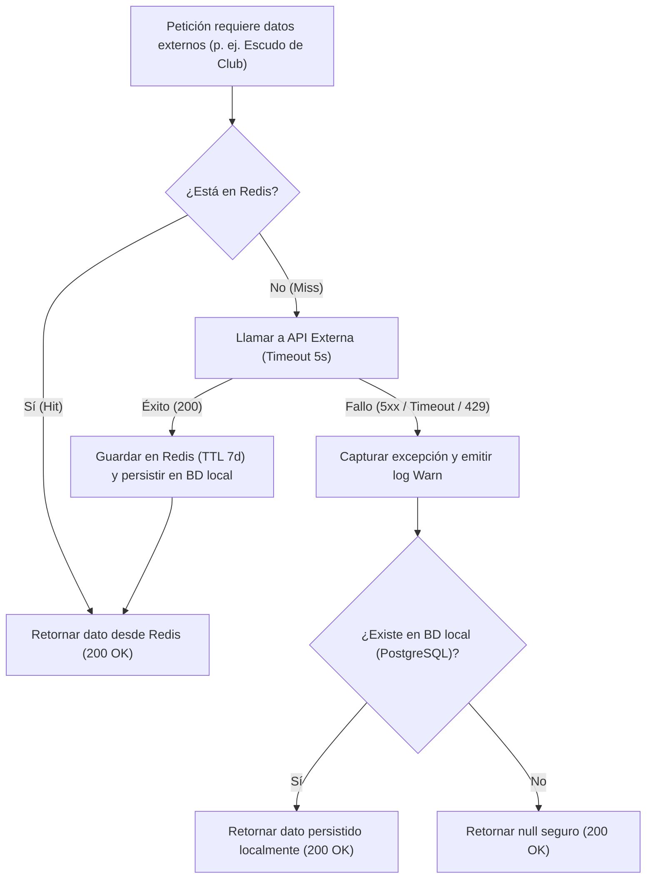

# Contrato de Degradación y Fallback ante Fallas Externas

**Feature**: `031-redis-cache-fallback` | **Date**: 2026-11-17

Este documento formaliza el comportamiento del sistema ante fallos, lentitud o límites de cuota de proveedores externos (Football-Data.org y WhoScored), garantizando la continuidad operativa según los Principios I y XIII.

---

## 1. Cascada de Resolución ante Consultas Externas

---

## 2. Matriz de Respuestas ante Errores Externos

| Escenario de Error Externo | Código Externo | Comportamiento del Sistema | Resultado hacia el Cliente | Nivel de Log |
|----------------------------|----------------|----------------------------|----------------------------|--------------|
| **Corte de red o DNS** | `ECONNREFUSED` / `ENOTFOUND` | Activa Fallback a Redis/BD local | HTTP 200 con datos locales o `null` | `warn` con stack |
| **Tiempo de espera agotado** | `ETIMEDOUT` / Axios Timeout (>5s) | Cancela petición y activa Fallback | HTTP 200 con datos locales o `null` | `warn` |
| **Límite de tasa excedido** | HTTP 429 *Too Many Requests* | Activa Fallback a Redis/BD local | HTTP 200 con datos locales o `null` | `warn` indicando límite |
| **Falla del servidor externo**| HTTP 500 / 502 / 503 / 504 | Activa Fallback a Redis/BD local | HTTP 200 con datos locales o `null` | `warn` |
| **Dato inexistente en externo**| HTTP 404 Not Found | Persiste `null` en BD y en Redis | HTTP 200 con `crestUrl: null` | `info` |

---

## 3. Garantías No Negociables
1. **Sin errores 500 al cliente**: Ningún fallo de un proveedor externo puede provocar una respuesta HTTP 5xx en endpoints públicos o autenticados de la plataforma (`GET /players`, `GET /players/:id`, `GET /players/ranking`).
2. **Sin placeholders inventados**: No se inventan URLs de escudos ficticias. Si el escudo no se encuentra, el valor retornado es `null`.
3. **Persistencia local resiliente**: Si una corrida de sincronización falla a mitad de camino, los datos previamente sincronizados y consolidados en PostgreSQL continúan sirviéndose normalmente.
